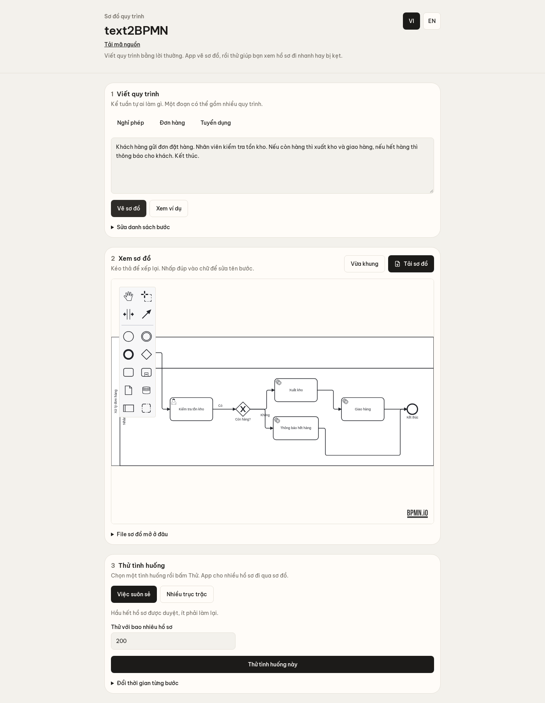

# text2BPMN

Mô tả quy trình bằng lời (tiếng Việt / tiếng Anh) → sơ đồ BPMN chỉnh sửa được → mô phỏng → event log CSV/XES.



## Kiến trúc


Chỉ bước LLM tốn token. Chi tiết: [docs/kien-truc-text2BPMN.pdf](docs/kien-truc-text2BPMN.pdf)

## Chạy

Cần Node 22.

```bash
npm install
npm run dev   # http://localhost:8080
```

Key là tùy chọn (không có key vẫn chạy ví dụ mẫu, mô phỏng và xuất log):

- `OPENROUTER_API_KEY` — model đặt bằng `OPENROUTER_MODEL` (mặc định `qwen/qwen3.5-9b`)
- hoặc `XAI_API_KEY`

## Kiểm tra yêu cầu và hai tầng checker — pilot

Sau khi có sơ đồ, dùng **Kiểm tra theo yêu cầu**: trích yêu cầu từ văn bản, rà câu nguồn, chọn checker nhẹ/mạnh/cascade và P0/P1/P2. Bộ kiểm đọc XML đang chỉnh trên canvas; khi sơ đồ hoặc yêu cầu đổi, kết quả cũ được đánh dấu hết hiệu lực. Có thể xuất JSON và tải đề xuất sửa riêng, chưa kiểm chứng; không tự thay bản gốc.

Cấu hình **phía server**, không đặt khóa trong trình duyệt hoặc Git:

- `OPENROUTER_API_KEY`: khóa đã cấp cho môi trường chạy.
- `OPENROUTER_CHECKER_ENABLED=true`: bật rõ các lời gọi checker có tính phí; mặc định tắt.
- `OPENROUTER_LIGHT_MODEL`: mặc định `meta-llama/llama-3.1-8b-instruct`.
- `OPENROUTER_STRONG_MODEL`: mặc định `qwen/qwen3-32b`.
- `OPENROUTER_CHECKER_PROVIDER`: mặc định `DeepInfra`, không tự fallback.
- `OPENROUTER_CHECKER_REQUEST_BUDGET`: mặc định 100 lượt/process; chỉ một workflow checker đồng thời/process. Đây không phải ngân sách bền vững hoặc kiểm soát truy cập cho triển khai công khai nhiều máy.

Generator vẫn dùng `OPENROUTER_MODEL` riêng; đổi checker không đổi generator. Không có lời gọi AI tự động khi tải trang. Nút thí nghiệm gọi sáu cấu hình trên cùng ứng viên; nó thu judgment, không tự xác định accuracy. Kết luận LLM và bảng yêu cầu trích tự động đều chưa phải chuẩn đúng; cascade hiện là heuristic chưa hiệu chỉnh.

```bash
npm run test:checker       # kiểm thử không tốn API
npm run test:checker:ui    # kiểm render; thêm -- --live để thử API qua UI local
npm run experiment:checker # dry-run; xem kế hoạch trước khi chạy có phí
npm run experiment:pet     # chạy benchmark PET; có gọi API tính phí
```

Benchmark PET fixture cho thấy qwen/qwen3-32b (B0-E0) đạt kết quả cao hơn trong đúng một thuộc tính thứ tự luồng trên BPMN tuần tự hai-task; không suy rộng thành correctness toàn quy trình, BPMN tổng quát hoặc prevalence lỗi Text2BPMN. Rubric và structured evidence không mặc định cải thiện kết quả. Chi phí là reported cost; 3/720 calls thiếu effective model/provider/cost. Xem báo cáo để biết khoảng bất định ghép cặp theo document. Xem [báo cáo benchmark PET](docs/experiments/pet-flow-checker-v3/README.md) và [kế hoạch triển khai](docs/semantic-checker-plan.md).

## Kết quả (qwen3.5-9b)

Các số liệu dưới đây là kết quả kỹ thuật có từ trước của nguyên mẫu, không phải benchmark ngữ nghĩa hoặc kết quả mới của hai checker.

Số cảnh báo mỗi lần chạy (3 lần), trước → sau khi sửa prompt:

| Ví dụ | Trước | Sau |
|---|---|---|
| Đặt hàng | 9 / 13 / 12 | 0 / 0 / 0 |
| Song song (onboarding) | 29 / 13 / 29 | 0 / 0 / 0 |
| Vòng lặp (sửa luận văn) | 21 / 41 / 18 | 0 / 1 / 1 |

PET dataset: 12/12 văn bản sinh được sơ đồ.

Kiểm tra log tự động (replay log trên sơ đồ, `verify.ts`): đặt hàng, song song, vòng lặp đều hợp lệ 50/50 và 200/200 hồ sơ ở cả "Việc suôn sẻ" lẫn "Nhiều trục trặc".

## Chi phí 1000 truy vấn

| Model | Chi phí |
|---|---|
| qwen3.5-9b | ≈ $0,29 thực trả ($0,40 theo bảng giá) |
| gemini-2.5-flash-lite | ≈ $0,38 (ước tính) |

Mô phỏng và xuất log: 0 token.
