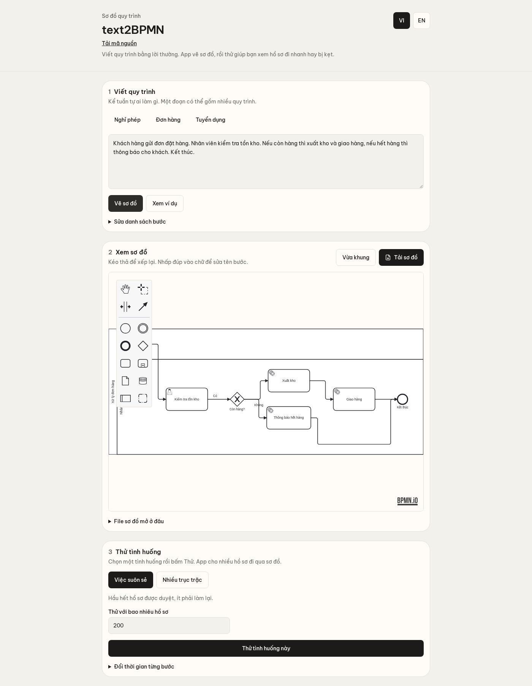

# text2BPMN

Mô tả quy trình bằng tiếng Việt hoặc tiếng Anh, app dùng LLM sinh sơ đồ BPMN cho phép chỉnh sửa, mô phỏng hai nhóm kịch bản (thuận lợi và có trục trặc), rồi xuất nhật ký sự kiện CSV/XES cho các công cụ process mining.



## Chạy (cần Node 22)

```bash
npm install
OPENROUTER_API_KEY=... npm run dev   # hoặc XAI_API_KEY=...
```

Mở http://localhost:8080. Không có key thì ví dụ sẵn, mô phỏng và xuất file vẫn dùng được. Đổi model bằng `OPENROUTER_MODEL` (mặc định `qwen/qwen3.5-9b`).

## Kiến trúc

Mô tả → LLM sinh IR (danh sách bước, prompt chặt có ví dụ mẫu và tự kiểm tra, sửa lại 1 lần nếu còn cảnh báo) → IR→BPMN (Python `ir_to_bpmn.py`, dự phòng JS) → bpmn-js → mô phỏng → CSV/XES. Chi tiết: [docs/kien-truc-text2BPMN.pdf](docs/kien-truc-text2BPMN.pdf).

## Đánh giá (`qwen/qwen3.5-9b`, 28/10/2026)

| Mô tả tiếng Việt (3 lần chạy) | Cảnh báo trước khi sửa prompt | Sau |
|---|---|---|
| Đặt hàng | 9 / 13 / 12 | 0 / 0 / 0 |
| Song song (onboarding) | 29 / 13 / 29 | 0 / 0 / 0 |
| Vòng lặp (sửa luận văn) | 21 / 41 / 18 | 0 / 1 / 1 |

Trên 12 văn bản tiếng Anh của [PET](https://huggingface.co/datasets/patriziobellan/PET): 12/12 ra sơ đồ, 9/12 không cảnh báo, recall nhãn hoạt động 0,48. Model 9B cho cấu trúc gần như luôn hợp lệ nhưng còn sót activity và XOR ở văn bản dài.

## Chi phí ước tính cho 1000 truy vấn

Mỗi truy vấn trung bình ~1.443 token vào và ~599 token ra (17% có gọi sửa lại). Mô phỏng và xuất CSV/XES chạy trong trình duyệt nên không tốn token.

| Model | Trung bình / 1000 truy vấn |
|---|---|
| `qwen/qwen3.5-9b` | ~$0,40 (thực trả đo được $0,29) |
| `google/gemini-2.5-flash-lite` | ~$0,38 (ước tính) |
| `qwen/qwen3.5-27b` | ~$1,93 (ước tính) |
| xAI Grok (mặc định) | ~$4,22 (ước tính, theo giá OpenRouter) |
